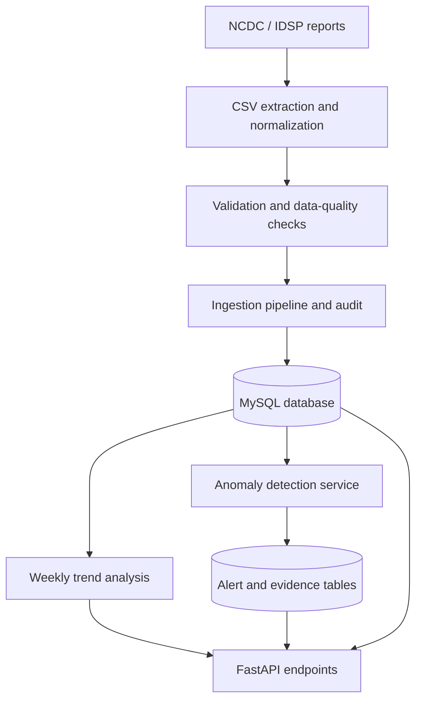

# OutbreakIQ — Disease Surveillance & Early Warning Intelligence System

**OutbreakIQ** is a Python-based disease surveillance backend that ingests outbreak records from NCDC/IDSP reports, validates and stores them in MySQL, and exposes analytical results through a FastAPI service.

The project focuses on traceable data ingestion, data quality, weekly disease trends and explainable anomaly alerts. An anomaly is an analytical signal for investigation; it is **not confirmation of an outbreak**.

## Project at a Glance

| Area | Implementation |
|---|---|
| Language | Python |
| API | FastAPI |
| Database | MySQL |
| Data processing | Pandas / Python |
| Validation | Pydantic and application-level checks |
| Testing | Pytest |
| Source domain | NCDC / IDSP weekly outbreak reports |

## Core Capabilities

- **CSV ingestion:** upload, normalize, validate and import outbreak records.
- **Data quality controls:** validate identifiers, disease/location fields, case and death counts, dates and status.
- **Source traceability:** retain source PDF metadata, reporting period and extraction references where available.
- **Repeatable imports:** prevent duplicate source rows and preserve weekly updates associated with an outbreak identifier.
- **Ingestion audit:** retain import-run information and data-quality outcomes.
- **Weekly trend analysis:** calculate observations and trailing historical baselines with configurable filters.
- **Explainable anomaly alerts:** evaluate percentage increases against previous observations and retain supporting evidence.
- **REST API:** expose ingestion, outbreak, trend and alert functionality through FastAPI.

## Architecture



## Anomaly Detection Method

The current deterministic rule is `case_increase_v1`.

- Default increase threshold: **50%**.
- Minimum historical observations: **4**.
- Lookback: up to **8 available previous observations**.
- Baseline: arithmetic mean of previous observations; the current observation is excluded.
- If the baseline is zero, percentage change is undefined and the increase rule does not generate an alert.

The baseline uses available observations, which are not guaranteed to represent consecutive calendar weeks. Sparse reporting and inconsistent disease/location labels can affect interpretation.

## API Surface

| Method | Endpoint | Purpose |
|---|---|---|
| GET | `/` | Service welcome/status |
| GET | `/health` | Health check |
| POST | `/ingestion-runs/csv` | Start an audited CSV ingestion run |
| GET | `/ingestion-runs/{run_id}` | Retrieve an ingestion run |
| POST | `/outbreaks` | Create an outbreak record |
| GET | `/outbreaks` | List outbreak records |
| GET | `/outbreaks/{unique_id}` | Retrieve an outbreak record |
| POST | `/outbreaks/upload-csv` | Validate and preview a CSV |
| POST | `/outbreaks/upload-and-import` | Validate and import a CSV |
| GET | `/analytics/trends` | Retrieve weekly trend observations |
| POST | `/analysis/run` | Run anomaly analysis |
| GET | `/alerts` | List anomaly alerts |
| GET | `/alerts/{alert_id}` | Retrieve an alert and its evidence |

Interactive API documentation is available at `/docs` when the application is running.

## Database Migrations

SQL migrations are in the `sql/` directory:

- `001_ingestion_audit.sql`
- `002_database_lineage.sql`
- `003_anomaly_alerts.sql`

Apply migrations in numerical order to a configured MySQL database.

## Run Locally

1. Clone the repository.
2. Create and activate a Python virtual environment.
3. Install the dependencies listed in `requirements.md`.
4. Configure the MySQL connection settings expected by `app/database.py`.
5. Create the database and apply the SQL migrations in order.
6. Start the API from the repository root:

```bash
uvicorn app.main:app --reload
```

Open `http://127.0.0.1:8000/docs` to explore the API.

Run the automated test suite from the repository root:

```bash
python -m pytest -q
```

> Configure credentials through local environment variables or a local configuration file. Never commit database passwords, API keys or other secrets.

## Verification Snapshot

The Module 04 implementation checkpoint recorded **52 passing tests** and one non-blocking deprecation warning, plus real-MySQL integration checks for alert/evidence persistence, retrieval and duplicate prevention. This is a dated development checkpoint, not a claim that every future commit has been re-tested.

See [Module 04 implementation checkpoint](docs/MODULE_04_CHECKPOINT.md) for test details, the real-data verification example and known limitations.

## Current Limitations & Roadmap

- Available observations are used for baselines; consecutive calendar-week validation is not yet enforced.
- Disease and location naming inconsistencies can split equivalent groups.
- Sparse or missing reporting periods need more robust treatment.
- The current alert rule is a percentage-increase heuristic, not a seasonal statistical model.
- Source-record traceability for aggregated weekly evidence needs further improvement.
- Alert acknowledgement/review workflows are not implemented.
- A planned investigation-brief integration must preserve evidence references and must never turn an anomaly into an unsupported outbreak declaration.

## Author

**Ashiba B** · Data Analytics · Python · SQL · Public Health Analytics

[LinkedIn](https://www.linkedin.com/in/ashiba-data-analyst) · [GitHub](https://github.com/ash-sheik)
